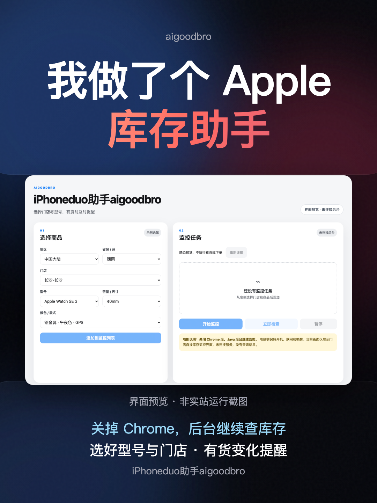
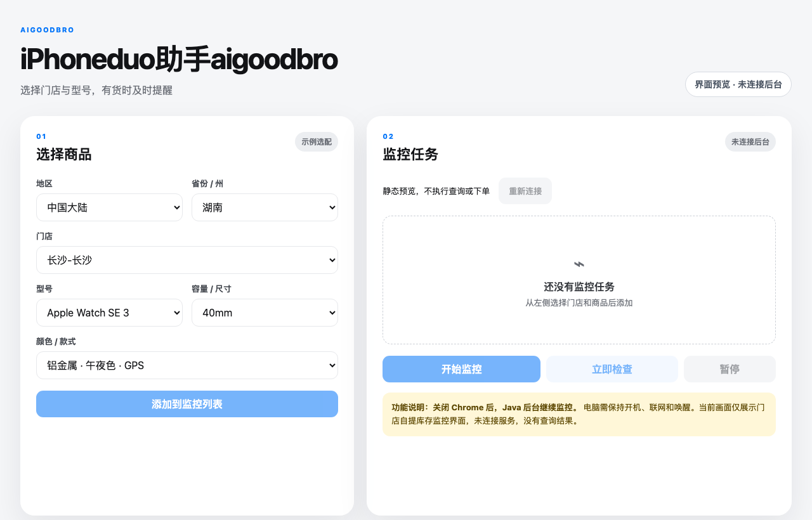

# iPhoneduo助手aigoodbro

用 Chrome 配置 Apple 门店库存监控，由本机 Java 后台持续查询，通过 Bark、飞书或 Lark 提醒。

官网：[aigoodbro.com](https://aigoodbro.com) · **1023v1 / 1.6.0 预发布测试版** · GPL-3.0。本次扩展已升级支持一键直达下单界面。

展示素材：**1016v7**（2026-10-16），图片展示此前版本界面；1023v1 新增购买选项见下方说明。



## 当前可用范围

- 按地区、门店、型号、容量或尺寸、颜色建立库存任务。
- Java 后台独立于 Chrome 运行。关闭浏览器后仍可查询，但电脑必须开机、登录、联网并保持唤醒。
- 可选 Bark、飞书和 Lark 通知；没有配置通知渠道时，仅记录库存状态。
- 503 / 429 时逐步延长等待时间，避免连续请求；故障显示未知，不当作有货或无货。
- 中国大陆商品页提供显式的“官网页查库存”单次查询，结果与 Java 后台分开显示。
- **一键直达下单界面**：扩展主界面点击「直达下单界面」，或在监控任务列表中点击「直达下单」，程序将自动进入官网完成商品规格选配、加入购物袋、穿透访客结账、选择门店自提最早时段与支付宝配置，并直接带您直达最终下单界面（“准备下单了吗？”页面），自动置顶标签页停在“立即下单”前，由人工核对后手动点击完成下单。
- 可选择仅使用已准备的购物袋；“按授权启动”可允许程序单次尝试生成未付款订单。
- “有货后结账一次”绑定现有 Java 自提库存任务，核对准确门店/SKU及新鲜库存后启动一次；保留金额、单件、付款方式和防重复提交保护。**真实官网自动下单尚未验收**。

**Apple Watch 当前只支持库存查询，不支持自动购买。** 内置商品目录来自上游和公开资料，不代表所有商品当前在售或有货。监控查询的是门店自提库存，不能据此判断邮寄供货。

本版已通过本地程序测试；官网仍可能返回 503，新增查询入口不保证解除限制。首次使用请先验证监控，保持自动购买的提交授权未勾选。程序不处理验证码、不读取账号 Cookie、不保存收货地址，不提供付款自动化。

1023v1 升级了**直达下单界面**能力：穿透访客结账与购物袋抽屉跳转，自动完成门店最早可用时段选择，到达下单界面后自动激活标签页与窗口前台置顶；同时在库存任务列表新增一键「直达下单」入口。

## 版本检测与升级提示

打开助手即可看到当前版本、最新公开版本和检查时间。自动检查结果缓存24小时；点“检查更新”可立即重查。发现新版时显示更新内容，可复制 Codex 更新口令；断网或数据无效会显示“检查失败”，不会误报已是最新版。检查仅获取本仓库的公开 `update.json`，不发送任务、通知地址或密钥，不自动下载或安装代码。

升级并重新加载后，扩展图标显示“新”，助手顶部显示“已升级至…”及本次变化；点“知道了”可清除提示。同版本重新加载不会重复提醒，回滚不称为升级。首次安装显示已载入版本。

更新前先停止旧购买任务，保留提交记录并核对官网已有订单；版本检测本身不会暂停或启动旧购买任务。更新后重载原扩展和已打开的Apple商品页即可生效。

## 直达下单界面怎么用

1. **从任务直达下单**：在已建立的监控任务列表中，直接点击该任务卡片右侧的「**直达下单**」按钮。扩展将自动以该商品的型号、颜色、容量及门店自提信息启动自动化，自动完成加袋、选时段、选支付宝，并在到达最终下单确认页（“准备下单了吗？”）时将浏览器标签页置顶激活，您只需核对并点击“立即下单”。
2. **在购买设置面板手动直达**：在第四部分「一键直达下单界面 / 自动购买」中选择型号、容量、颜色和金额上限，选择“指定门店自提”或“邮寄”，然后点击主按钮「**直达下单界面**」。它将自动执行所有中间流程，停在最终点击下单之前。
3. **需要自动生成未付款订单时**：核对官网现有资料，勾选“允许程序生成 1 件未付款订单”及销售条款授权，再点「按授权启动」；付款步骤停止。已有提交记录必须先核对官网订单，确认新订单后才能另起一次。
4. **到货触发自提结账**：添加相同门店/SKU 的唯一监控任务并启动监控，再点“有货后结账一次”。只有启用后产生、非未来且60秒内的准确有货结果可触发，消费后不重复开启。暂停、重启监控配置或修改任务会取消等待。

自动结账需要 Chrome 运行。扩展每30秒读取本机 Java 状态，不额外请求 Apple；网页单次库存查询不触发购买。关闭 Chrome 后，Java 可继续监控和提醒，但不会操作网页结账。

## 界面预览



封面与上图均由本项目界面和内置目录静态渲染，**不是已安装扩展或 Apple 官网实站运行截图**。图中 Watch 选配仅用于展示，未连接后台、未查询库存、未创建订单。

## 让 Codex 协助安装

把下面这一句话复制给 Codex：

```text
请用 Codex 协助我安装或更新 https://github.com/BLACKIELF/iphoneduo-aigoodbro 的 iPhoneduo助手aigoodbro 至 1.6.0（1023v1）：先读 README，复用已有同源安装及原扩展目录，保留本地改动、任务、设置和库存监控状态，先停止旧购买任务，比较版本后更新必要文件，Java 后台无变化则不重装，协助重新加载扩展并核验版本、固定 ID 和后台连接，不自动恢复购买或付款；不能操作扩展管理页时给我手动重载步骤，缺少安装才按 README 安装并保持暂停。
```

## 安装（macOS + Google Chrome）

需要 Git、可运行的 `/usr/bin/python3` 和 JDK 21。扩展至少需要 Chrome 120。当前安装器不支持 Windows、Linux 或其他浏览器。Node.js 仅用于开发测试。

先检查是否已有同源安装；已有用户应保留当前扩展目录，更新原目录后重新加载，避免生成第二份配置。安装器会复用本机服务并保留任务、设置与启用状态；**更新正在监控的安装不会自动暂停它**。同名但指向其他位置的服务会拒绝覆盖。

```bash
git clone https://github.com/BLACKIELF/iphoneduo-aigoodbro.git
cd iphoneduo-aigoodbro
/usr/bin/python3 -c 'import json, urllib.request'
```

构建脚本默认使用 Apple Silicon Homebrew 的 `/opt/homebrew/opt/openjdk@21/bin`。其他安装路径先在当前终端设置 `APPLE_HELPER_JDK_BIN` 为实际 JDK 21 的 `bin` 目录；如果 JDK 已注册到 macOS，可执行：

```bash
export APPLE_HELPER_JDK_BIN="$(/usr/libexec/java_home -v 21)/bin"
```

确认该目录包含 `java`、`javac` 和 `jar`，再构建和安装。安装脚本不下载 JDK、不更改全局 PATH：

```bash
sh work/backend/build.sh
/usr/bin/python3 work/backend/install_macos.py
```

1. 在 Chrome 扩展管理页打开开发者模式，选择“加载已解压的扩展程序”，加载本仓库的 `work/extension` 文件夹。
2. 确认名称为 `iPhoneduo助手aigoodbro`，版本为 `1.6.0`，扩展 ID 为 `agooghaedakdaimodmlajgkgondpjjil`。
3. 打开助手，确认后台已连接。首次安装没有任务且保持暂停。
4. 添加自己的门店与商品，点击“立即检查”进行一轮查询。确认商品与门店对应正确；503 表示库存未知，等待冷却后再查，不能视为安装成功取得库存。
5. 需要持续监控时再点击“开始监控”。关闭 Chrome 后仍要接收提醒，需先配置通知渠道。

更新扩展后，也要刷新已打开的 Apple 商品页才能加载新增脚本。使用“官网页查库存”时，需先自行打开中国大陆 Apple 官网商品页并完成必要验证；该结果不会启动购买或发送库存通知。

## 数据与通知

任务、通知地址和签名密钥仅存放在本机运行目录与扩展本地缓存，不使用 Chrome 同步；它们不是加密保险箱。版本检测仅向 GitHub 请求公开元数据，缓存保存在本机。后台运行目录为 `~/Library/Application Support/ApplePurchaseHelper/`，目录权限 0700，状态与配对密钥权限 0600。

启用提醒后，所选门店、型号、规格和官网商品链接会发送至用户配置的渠道。保存设置不会发送消息。Bark 仅支持 `api.day.app`；飞书和 Lark 仅支持官方 HTTPS 机器人接口。后台仅监听 `127.0.0.1`，扩展通过 Native Messaging 连接。

## 停止与卸载

先在助手中暂停监控。仅卸载扩展不会停止 Java 后台。停止当前登录服务：

```bash
launchctl bootout "gui/$(id -u)/com.aigoodbro.apple-helper"
```

取消以后登录启动时，将 `~/Library/LaunchAgents/com.aigoodbro.apple-helper.plist` 移到废纸篓，再移除 Chrome 扩展及 `~/Library/Application Support/Google/Chrome/NativeMessagingHosts/com.aigoodbro.apple_helper.json`。保留运行目录可保留任务；不会自动删除 JDK 或个人配置。

## 开发与验证

```bash
npm --prefix work/extension test
npm --prefix work/extension run check
sh work/backend/build.sh
cd work/backend
/usr/bin/python3 -m unittest test_native_host.py test_install_macos.py
```

测试覆盖版本检测、升级已读提示、精确门店/SKU 解析、503/429 冷却、取消和晚到响应、通知去重、金额/商品/数量/付款方式核对及重复提交保护。测试使用隔离夹具，不访问用户购物袋、不创建真实订单。离线通过不能替代真实官网验收。维护新版时需同步扩展 manifest、release-info.js 与仓库根 update.json，先通过测试再发布。

## 来源

基于 [Sunbelife/apple-store-helper-15](https://github.com/Sunbelife/apple-store-helper-15) 的商品、门店与扩展配置，结合 [MoshiCoCo/Apple-Monitor](https://github.com/MoshiCoCo/Apple-Monitor) 的查询和通知协议；适配 [suversal/apple-store-inventory-monitor](https://github.com/suversal/apple-store-inventory-monitor) 的自提地区、门店、时段、联系人核验、支付宝与结账步骤，并接入本项目的授权和单次提交状态机。相关 GPL 许可和来源声明随仓库提供；未引入其浏览器控制器或反检测功能。

完整来源、版本及修改说明见 [SOURCES.md](work/extension/SOURCES.md)。软件不隶属于 Apple，不保证库存、供货或下单成功。
